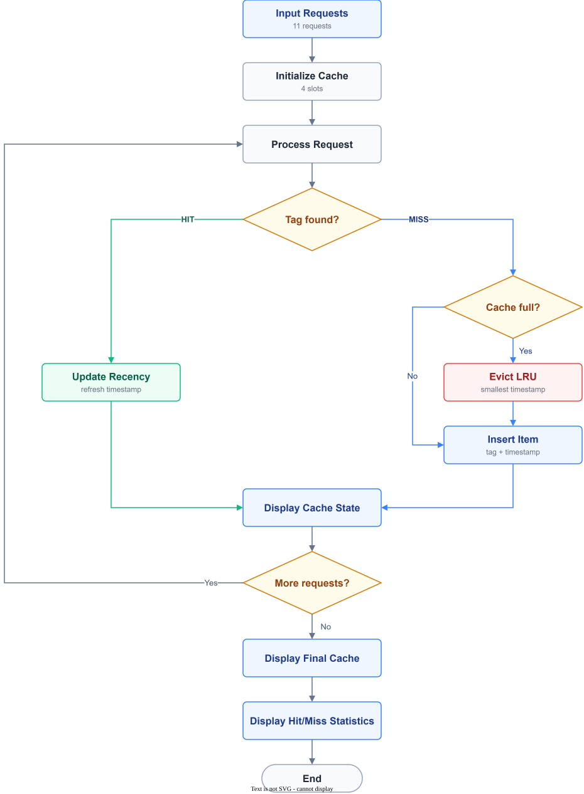
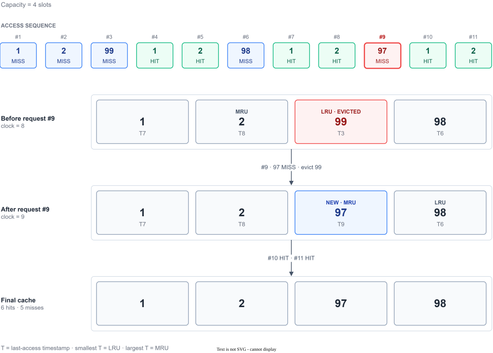
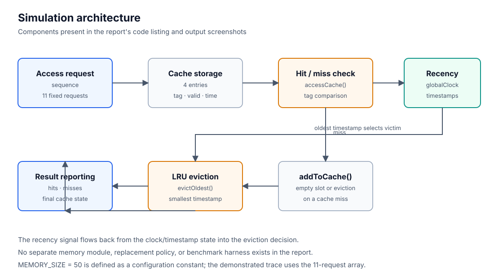

# LRU Cache Management Simulator

An educational C simulation of cache hits, misses, LRU eviction, and working-set protection. The project models a four-entry cache and shows how frequently used data survives a short sequence of one-off accesses.

`C` · `LRU replacement` · `cache simulation` · `serial output`

> This repository publishes the final academic report and explanatory diagrams. It contains no separate runnable source file; the complete code listing is in the report.

---

## Overview

Cache management decides which data stays in a small, fast storage layer. When a program repeatedly requests the same items, keeping them close avoids slower main-memory access. **Cache pollution** happens when one-off accesses fill the cache and push out frequently used data. The resulting repeated misses are what the report describes as **thrashing**.

This project uses **Least Recently Used (LRU)** replacement to protect a frequently accessed working set. Every access carries a logical timestamp; when the cache is full, the entry with the oldest timestamp is replaced. The simulation prints each cache state so the eviction decisions can be followed in real time.

## How LRU Works

LRU assumes that the item used longest ago is the least likely to be needed next.

- A **hit** means the requested tag is already cached. Its timestamp is refreshed, so it becomes recently used again.
- A **miss** means the tag is absent. The item is inserted into an empty slot, or, when all slots are occupied, it replaces the least recently used entry.
- The "least recently used" entry is the valid slot with the smallest timestamp.

A short example from the report's trace:

| Request | Outcome | Effect on recency |
|---:|---|---|
| 1 | MISS | Inserted into slot 0 at time 1 |
| 2 | MISS | Inserted into slot 1 at time 2 |
| 99 | MISS | Inserted into slot 2 at time 3 |
| 1 | HIT | Timestamp refreshed to time 4 |
| 2 | HIT | Timestamp refreshed to time 5 |

Later, request `97` arrives with all four slots occupied. Entry `99` has the oldest timestamp (`T3`), so it is evicted and replaced by `97`. The frequently accessed items `1` and `2` remain.

## Methodology

The simulation follows a fixed, code-derived workflow:

1. Initialize four cache slots as invalid, with `tag = -1` and `time = 0`.
2. For each request in `{1, 2, 99, 1, 2, 98, 1, 2, 97, 1, 2}`, advance the logical clock.
3. Search for the tag with `accessCache()`.
4. On a hit, refresh the slot's timestamp. On a miss, insert into an empty slot with `addToCache()`, or call `evictOldest()` when the cache is full.
5. Print the cache state after every request.
6. Report totals, final cache contents, and whether the working set survived.

The full step-by-step trace, configuration table, and editable Mermaid source are in [Methodology](docs/METHODOLOGY.md).

## Cache Operation Visualization

The diagram below uses the verified trace. At clock 8 the cache holds `1`, `2`, `99`, and `98`; `99` has the oldest timestamp. Request `97` misses, all slots are full, so `evictOldest()` replaces `99`. Red marks the least recently used entry and green marks the newly inserted one.

The architecture diagram shows how the request sequence, cache storage, hit/miss check, recency tracking, eviction, and reporting connect in the published implementation.

## Results and Observations

The report's output screenshots confirm:

| Metric | Value |
|---|---:|
| Requests processed | 11 |
| Cache hits | 6 |
| Cache misses | 5 |
| Final cache contents | `{1, 2, 97, 98}` |

The final message is `SUCCESS: Cache Pollution avoided.` The working set `{1, 2}` remained in the cache despite the one-off accesses `99`, `98`, and `97`. These are the only results reported; no performance percentages or benchmark comparisons are claimed.

## Technologies

- C, written as an Arduino-style sketch with `setup()` and `loop()`
- Serial output via `Serial.begin(115200)` and the Arduino Serial Monitor
- ESP32 Dev Module reference shown in the output screenshot
- Core concepts: working set, cache pollution, thrashing, LRU replacement

## Team Members

The original academic work was completed collaboratively by:

- Nafis Afzal
- Fahim Monaym
- Jalal Uddin Mohammad Rumi
- Istiaque ahmed
- Md Ahsiul Karim

## Final Report

[Read or download the final approved report (PDF)](Simulating_Cache_Management_Policies.pdf)

The seven-page report contains the project description, features, complete code listing, and output screenshots. It is the only report version published here.

## Academic Attribution

This collaborative academic project was completed by the team members listed above and submitted to **Md. Adnan Morshed, Lecturer, Department of Computer Science and Engineering, East West University**. The academic work, implementation, analysis, and findings presented in the report are the collective contributions of the team.

The GitHub repository setup and maintenance, README documentation, and supplementary diagrams were prepared by **Nafis Afzal**. These contributions relate to the presentation and organization of the repository and do not change the collaborative authorship of the original academic report.

**Licensing:** No open-source license has been granted. Public availability of this repository does not imply permission to reproduce, modify, redistribute, or otherwise reuse its contents.
