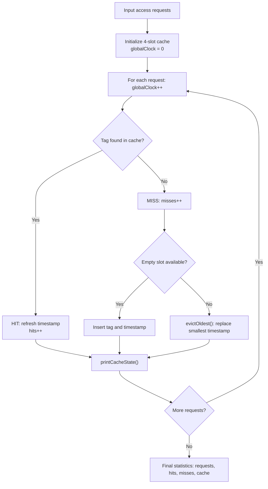

# Methodology

This document explains the simulation described in the [final report](../Simulating_Cache_Management_Policies.pdf). The repository publishes the report only; it does not include a separate runnable source file. All details below come from the code listing and output screenshots in that report.

## Scope and configuration

| Item | Verified value |
|---|---|
| Cache size | `CACHE_SIZE 4` — four slots |
| Memory constant | `MEMORY_SIZE 50` — defined in the report |
| Cache entry | `tag`, `valid`, and `time` (logical timestamp) |
| Clock | `globalClock`, advanced once per request |
| Request sequence | `{1, 2, 99, 1, 2, 98, 1, 2, 97, 1, 2}` |
| Initialization | `valid = false`, `tag = -1`, `time = 0` |
| Output | Serial Monitor at 115200 baud; cache state printed after every request |

The implementation is a teaching simulation of a direct four-entry cache. It is not a production cache or a benchmark harness.

## Algorithm

1. **Initialize** every slot as invalid, with tag `-1` and time `0`. Set counters and the logical clock to zero.
2. **For each request**, advance `globalClock`.
3. **Check the cache** with `accessCache()`. If a valid slot has the requested tag, it is a hit: refresh that slot's `time` to `globalClock`.
4. **On a miss**, call `addToCache()`:
   - If a slot is invalid, insert the tag and set its timestamp.
   - If all slots are valid, call `evictOldest()`, which finds the entry with the smallest timestamp and replaces its tag and timestamp.
5. **Print the cache state** with `printCacheState()`.
6. After the trace, print total requests, hits, misses, the final cache contents, and a working-set survival message.

## Verified trace

The states below were reproduced from the report's code. `T` is the timestamp stored in the slot.

| # | Request | Outcome | Cache after the request |
|---:|---:|---|---|
| 1 | 1 | MISS — insert into empty slot 0 | `1:T1 · EMPTY · EMPTY · EMPTY` |
| 2 | 2 | MISS — insert into empty slot 1 | `1:T1 · 2:T2 · EMPTY · EMPTY` |
| 3 | 99 | MISS — insert into empty slot 2 | `1:T1 · 2:T2 · 99:T3 · EMPTY` |
| 4 | 1 | HIT — refresh recency | `1:T4 · 2:T2 · 99:T3 · EMPTY` |
| 5 | 2 | HIT — refresh recency | `1:T4 · 2:T5 · 99:T3 · EMPTY` |
| 6 | 98 | MISS — insert into empty slot 3 | `1:T4 · 2:T5 · 99:T3 · 98:T6` |
| 7 | 1 | HIT — refresh recency | `1:T7 · 2:T5 · 99:T3 · 98:T6` |
| 8 | 2 | HIT — refresh recency | `1:T7 · 2:T8 · 99:T3 · 98:T6` |
| 9 | 97 | MISS — evict `99` (T3), insert `97` | `1:T7 · 2:T8 · 97:T9 · 98:T6` |
| 10 | 1 | HIT — refresh recency | `1:T10 · 2:T8 · 97:T9 · 98:T6` |
| 11 | 2 | HIT — refresh recency | `1:T10 · 2:T11 · 97:T9 · 98:T6` |

**Reported result:** 11 requests, 6 hits, 5 misses, final cache `{1, 2, 97, 98}`, and the message `SUCCESS: Cache Pollution avoided.` The frequently accessed working set `{1, 2}` remains in the cache.

## Workflow diagram source

This Mermaid source mirrors the SVG workflow in [`assets/lru-workflow.svg`](../assets/lru-workflow.svg).

## Conceptual versus exact

The diagrams describe the exact control flow of the published code. Terms such as "working set" and "pollution" are the report's own descriptions of the demonstration scenario; they do not imply a production-grade replacement policy or measured system performance.
